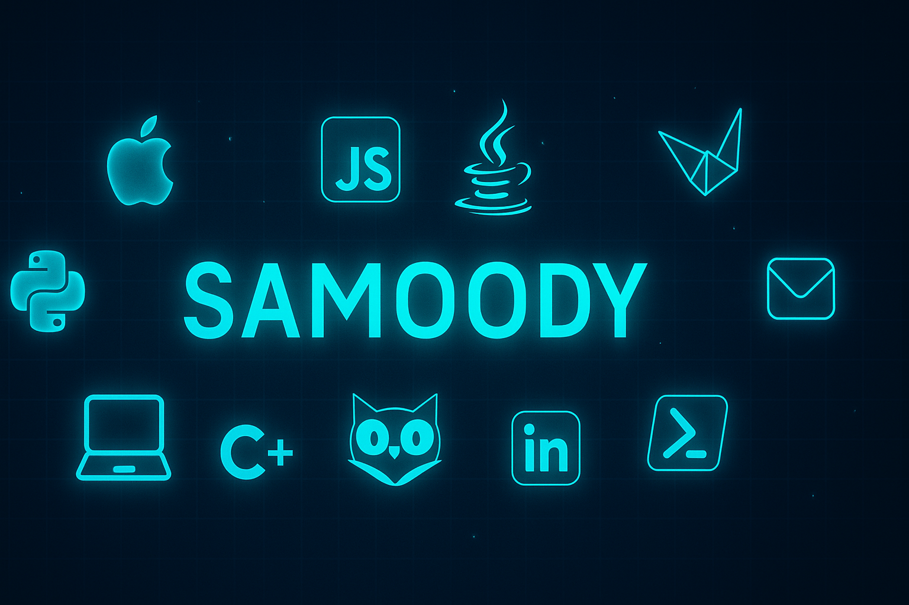

<div align="center">

<!-- Banner -->


<!-- Top 0.1% Hacker Badge -->
<p>


</p>

<!-- Terminal Typing Intro -->


</div>

---

## 🖥️ Terminal Hacker Mode

```bash
[00:00] > Initializing system...
[00:01] > Loading Java Backend Modules...
[00:02] > Python APIs starting...
[00:03] > Connecting MySQL & PostgreSQL Databases...
[00:04] > GitHub Profile Top 0.1% loaded
[00:05] > Neo Mode Activated
[00:06] > Running Snake Contributions...
[00:07] > Live Coding Modules Online
[00:08] > Spotify Data Fetched
[00:09] > Matrix Terminal Ready
```

<h2 align="center">💻 Backend Developer em formação • Java • Python • APIs</h2>

<p align="center">Estudante de Engenharia da Computação focado em backend, APIs e desenvolvimento de software.</p>

<div align="center">

</div>

<!-- Matrix Terminal GIF -->
<div align="center">

</div>

<!-- Terminal Typing Intro -->
<div align="center">

</div>

---

## 👨‍💻 Sobre mim

- 💻 Desenvolvedor backend em formação
- 🎓 Estudante de Engenharia da Computação
- 🎧 DJ nas horas vagas
- 🎮 Fã de jogos clássicos online
- ⚽ Torcedor do Flamengo
- 💬 Gosto de aprender novas tecnologias e ajudar pessoas
- 📫 Contato: **samuelmoody679@gmail.com**

---

## 🎬 Séries e Filmes Favoritos

📺 Séries:

- <a href="https://www.imdb.com/title/tt0369179/">Two and a Half Men</a>
- <a href="https://www.imdb.com/title/tt0904208/">Californication</a>
- <a href="https://www.imdb.com/title/tt0141842/">The Sopranos</a>
- <a href="https://www.imdb.com/title/tt0460681/">Supernatural</a>
- <a href="https://www.imdb.com/title/tt0487831/">The IT Crowd</a>

🎥 Filmes:

- <a href="https://www.imdb.com/title/tt0068646/">The Godfather</a>
- <a href="https://www.imdb.com/title/tt0076759/">Star Wars</a>
- <a href="https://www.imdb.com/title/tt0055630/">Por um Punhado de Dólares</a>
- <a href="https://www.imdb.com/title/tt0064116/">Por Uns Dólares a Mais</a>
- <a href="https://www.imdb.com/title/tt0065126/">Três Homens em Conflito</a>
- <a href="https://www.imdb.com/title/tt0096895/">Batman</a>
- <a href="https://www.imdb.com/title/tt0477348/">Onde os Fracos Não Têm Vez</a>
- <a href="https://www.imdb.com/title/tt0117571/">Pânico</a>

---

## 🚀 Projetos em destaque

| Projeto | Tecnologias |
|-------|-------------|
| Sistema de Controle de Estoque | Java • MySQL |
| API Caixa Eletrônico | Python |
| Gerador de Relatórios Automáticos | Python |
| Portfólio Web | HTML • CSS • JavaScript |

---

## 🛠️ Tecnologias

### Backend


### Frontend


### Banco de dados


### Ferramentas


---

## 🖥 Hacker Terminal

<div align="center">

</div>

---

## 🧠 Linguagens mais usadas

<div align="center">


</div>

<!-- Backup, se a instância acima cair: use esta linha no lugar da imagem -->
<!--  -->

---

## ⚡ Developer Skills (Hacker Mode)

<div align="center">

</div>

---

## 🟢 Matrix Code

<div align="center">

</div>

---

## 📈 GitHub Activity Graph

<div align="center">

</div>

---

## 💻 Live Coding

<div align="center">

</div>

---

## 🐍 Snake Contributions

<div align="center">

</div>

<!-- Para usar a SUA cobrinha: rode o workflow "generate-snake-game-from-github-contribution-grid"
     e depois troque a src acima por:
     https://raw.githubusercontent.com/samoody/samoody/main/output/github-contribution-grid-snake.svg -->

---

## 🌐 Contatos

<div align="center">

<a href="https://github.com/samoody">

</a>
<a href="mailto:samuelmoody679@gmail.com">

</a>
<a href="https://www.linkedin.com/in/samoody1">

</a>
<a href="https://wa.me/5531993938538">

</a>

<br/><br/>

<!-- Visitor badge azul -->


</div>

---

## 📊 GitHub Stats

<div align="center">


</div>

<!-- Backup, se a instância acima cair: use esta linha no lugar do card de Stats -->
<!--  -->

---

## 🎧 Spotify

<details>
<summary>

&nbsp; Sam Moody's Spotify Data
</summary>

<br/>

<div align="center">


</div>

</details>

---

## 🎵 Música em destaque

<details>
<summary>:headphones: :guitar: :drum:</summary>

<br/>

<div align="center">

<a href="https://github.com/joaopauloaramuni/joaopauloaramuni/assets/58268075/c6568311-54c8-4c00-aced-26aacd69f8a1">

</a>

</div>

</details>

---

## 📈 Métricas do perfil

<div align="center">


<br/><br/>


<br/><br/>

<a href="https://samoody.github.io/pix20.png" target="_blank">

</a>

</div>
